# YUEL

Automated pipeline that collects publicly published **plain SOCKS4/SOCKS5/HTTP
proxy servers** — bare `ip:port` / `ip:port:user:pass` entries — really tests
which ones are alive (and which protocol each one actually speaks), scores and
tiers them by quality, classifies them by country, and publishes
machine-readable files that a proxy-chaining consumer can use directly to
swap its egress hop (e.g. "give me an Italian exit").

**These are NOT tunnel configs.** YUEL deliberately does not handle
`vmess://` / `vless://` / `trojan://` / `ss://` / `hysteria2://` / `tuic://`
URIs — those are standalone VPN endpoints with their own tunnel encryption,
a different product (that was the pre-0.3.0 scope; it has been removed).
Plain proxies chain in FRONT of or BEHIND another connection as an outbound
hop; their output contract below is different by design and must never be
confused with a tunnel-config feed downstream.

**Status: all seven stages are implemented and running end-to-end — the
full pipeline executes automatically on GitHub Actions every 30 minutes,
and every number in this README comes from the latest published
`data/out/run-summary.json` (last run 2026-11-20 08:24 UTC: 1,875 alive ·
80 countries).**

This repository is a fresh, independently written codebase. It shares no
code, config, or history with any other project.

---

<p align="center">
  <picture>
    <source media="(prefers-color-scheme: dark)" srcset="assets/brand/yuel-logo-white.png">
    
  </picture>
</p>

<p align="center">
  <picture>
    <source media="(prefers-color-scheme: dark)" srcset="assets/dark/header.svg">
    
  </picture>
</p>

<p align="center">
  <picture>
    <source media="(prefers-color-scheme: dark)" srcset="assets/dark/stats.svg">
    
  </picture>
</p>

## Top 20 countries — grab a list

Live counts from the last published run. Click a card to grab that
country's **combined** plain-text list (`type://ip:port`, one proxy per
line, best score first) — no JSON parsing needed. Expand a card for the
per-type files. Not on the list? Every country with alive proxies has the
exact same files under `data/out/by-country/`.

<!-- country-grid:start -->

<table>
<tr><td><a href="https://raw.githubusercontent.com/Edsel-Rahimi/YUEL/main/data/out/by-country/CN.txt"><picture><source media="(prefers-color-scheme: dark)" srcset="assets/dark/country-CN.svg"></picture></a><br><details><summary>socks5 · socks4 · http</summary><a href="https://raw.githubusercontent.com/Edsel-Rahimi/YUEL/main/data/out/by-country/CN/socks5.txt"><code>socks5 · 673</code></a> · <a href="https://raw.githubusercontent.com/Edsel-Rahimi/YUEL/main/data/out/by-country/CN/socks4.txt"><code>socks4 · 35</code></a> · <a href="https://raw.githubusercontent.com/Edsel-Rahimi/YUEL/main/data/out/by-country/CN/http.txt"><code>http · 222</code></a></details></td><td><a href="https://raw.githubusercontent.com/Edsel-Rahimi/YUEL/main/data/out/by-country/US.txt"><picture><source media="(prefers-color-scheme: dark)" srcset="assets/dark/country-US.svg"></picture></a><br><details><summary>socks5 · socks4 · http</summary><a href="https://raw.githubusercontent.com/Edsel-Rahimi/YUEL/main/data/out/by-country/US/socks5.txt"><code>socks5 · 187</code></a> · <a href="https://raw.githubusercontent.com/Edsel-Rahimi/YUEL/main/data/out/by-country/US/socks4.txt"><code>socks4 · 4</code></a> · <a href="https://raw.githubusercontent.com/Edsel-Rahimi/YUEL/main/data/out/by-country/US/http.txt"><code>http · 64</code></a></details></td><td><a href="https://raw.githubusercontent.com/Edsel-Rahimi/YUEL/main/data/out/by-country/ID.txt"><picture><source media="(prefers-color-scheme: dark)" srcset="assets/dark/country-ID.svg"></picture></a><br><details><summary>socks5 · socks4 · http</summary><a href="https://raw.githubusercontent.com/Edsel-Rahimi/YUEL/main/data/out/by-country/ID/socks5.txt"><code>socks5 · 1</code></a> · <a href="https://raw.githubusercontent.com/Edsel-Rahimi/YUEL/main/data/out/by-country/ID/socks4.txt"><code>socks4 · 3</code></a> · <a href="https://raw.githubusercontent.com/Edsel-Rahimi/YUEL/main/data/out/by-country/ID/http.txt"><code>http · 70</code></a></details></td><td><a href="https://raw.githubusercontent.com/Edsel-Rahimi/YUEL/main/data/out/by-country/DE.txt"><picture><source media="(prefers-color-scheme: dark)" srcset="assets/dark/country-DE.svg"></picture></a><br><details><summary>socks5 · socks4 · http</summary><a href="https://raw.githubusercontent.com/Edsel-Rahimi/YUEL/main/data/out/by-country/DE/socks5.txt"><code>socks5 · 20</code></a> · <code>socks4 · 0</code> · <a href="https://raw.githubusercontent.com/Edsel-Rahimi/YUEL/main/data/out/by-country/DE/http.txt"><code>http · 30</code></a></details></td></tr>
<tr><td><a href="https://raw.githubusercontent.com/Edsel-Rahimi/YUEL/main/data/out/by-country/GB.txt"><picture><source media="(prefers-color-scheme: dark)" srcset="assets/dark/country-GB.svg"></picture></a><br><details><summary>socks5 · socks4 · http</summary><a href="https://raw.githubusercontent.com/Edsel-Rahimi/YUEL/main/data/out/by-country/GB/socks5.txt"><code>socks5 · 41</code></a> · <code>socks4 · 0</code> · <a href="https://raw.githubusercontent.com/Edsel-Rahimi/YUEL/main/data/out/by-country/GB/http.txt"><code>http · 5</code></a></details></td><td><a href="https://raw.githubusercontent.com/Edsel-Rahimi/YUEL/main/data/out/by-country/HK.txt"><picture><source media="(prefers-color-scheme: dark)" srcset="assets/dark/country-HK.svg"></picture></a><br><details><summary>socks5 · socks4 · http</summary><a href="https://raw.githubusercontent.com/Edsel-Rahimi/YUEL/main/data/out/by-country/HK/socks5.txt"><code>socks5 · 12</code></a> · <a href="https://raw.githubusercontent.com/Edsel-Rahimi/YUEL/main/data/out/by-country/HK/socks4.txt"><code>socks4 · 5</code></a> · <a href="https://raw.githubusercontent.com/Edsel-Rahimi/YUEL/main/data/out/by-country/HK/http.txt"><code>http · 15</code></a></details></td><td><a href="https://raw.githubusercontent.com/Edsel-Rahimi/YUEL/main/data/out/by-country/ZW.txt"><picture><source media="(prefers-color-scheme: dark)" srcset="assets/dark/country-ZW.svg"></picture></a><br><details><summary>socks5 · socks4 · http</summary><code>socks5 · 0</code> · <code>socks4 · 0</code> · <a href="https://raw.githubusercontent.com/Edsel-Rahimi/YUEL/main/data/out/by-country/ZW/http.txt"><code>http · 25</code></a></details></td><td><a href="https://raw.githubusercontent.com/Edsel-Rahimi/YUEL/main/data/out/by-country/RU.txt"><picture><source media="(prefers-color-scheme: dark)" srcset="assets/dark/country-RU.svg"></picture></a><br><details><summary>socks5 · socks4 · http</summary><a href="https://raw.githubusercontent.com/Edsel-Rahimi/YUEL/main/data/out/by-country/RU/socks5.txt"><code>socks5 · 10</code></a> · <a href="https://raw.githubusercontent.com/Edsel-Rahimi/YUEL/main/data/out/by-country/RU/socks4.txt"><code>socks4 · 1</code></a> · <a href="https://raw.githubusercontent.com/Edsel-Rahimi/YUEL/main/data/out/by-country/RU/http.txt"><code>http · 10</code></a></details></td></tr>
<tr><td><a href="https://raw.githubusercontent.com/Edsel-Rahimi/YUEL/main/data/out/by-country/TR.txt"><picture><source media="(prefers-color-scheme: dark)" srcset="assets/dark/country-TR.svg"></picture></a><br><details><summary>socks5 · socks4 · http</summary><code>socks5 · 0</code> · <a href="https://raw.githubusercontent.com/Edsel-Rahimi/YUEL/main/data/out/by-country/TR/socks4.txt"><code>socks4 · 3</code></a> · <a href="https://raw.githubusercontent.com/Edsel-Rahimi/YUEL/main/data/out/by-country/TR/http.txt"><code>http · 13</code></a></details></td><td><a href="https://raw.githubusercontent.com/Edsel-Rahimi/YUEL/main/data/out/by-country/BD.txt"><picture><source media="(prefers-color-scheme: dark)" srcset="assets/dark/country-BD.svg"></picture></a><br><details><summary>socks5 · socks4 · http</summary><code>socks5 · 0</code> · <a href="https://raw.githubusercontent.com/Edsel-Rahimi/YUEL/main/data/out/by-country/BD/socks4.txt"><code>socks4 · 5</code></a> · <a href="https://raw.githubusercontent.com/Edsel-Rahimi/YUEL/main/data/out/by-country/BD/http.txt"><code>http · 9</code></a></details></td><td><a href="https://raw.githubusercontent.com/Edsel-Rahimi/YUEL/main/data/out/by-country/CH.txt"><picture><source media="(prefers-color-scheme: dark)" srcset="assets/dark/country-CH.svg"></picture></a><br><details><summary>socks5 · socks4 · http</summary><code>socks5 · 0</code> · <code>socks4 · 0</code> · <a href="https://raw.githubusercontent.com/Edsel-Rahimi/YUEL/main/data/out/by-country/CH/http.txt"><code>http · 14</code></a></details></td><td><a href="https://raw.githubusercontent.com/Edsel-Rahimi/YUEL/main/data/out/by-country/TH.txt"><picture><source media="(prefers-color-scheme: dark)" srcset="assets/dark/country-TH.svg"></picture></a><br><details><summary>socks5 · socks4 · http</summary><code>socks5 · 0</code> · <a href="https://raw.githubusercontent.com/Edsel-Rahimi/YUEL/main/data/out/by-country/TH/socks4.txt"><code>socks4 · 4</code></a> · <a href="https://raw.githubusercontent.com/Edsel-Rahimi/YUEL/main/data/out/by-country/TH/http.txt"><code>http · 10</code></a></details></td></tr>
<tr><td><a href="https://raw.githubusercontent.com/Edsel-Rahimi/YUEL/main/data/out/by-country/BR.txt"><picture><source media="(prefers-color-scheme: dark)" srcset="assets/dark/country-BR.svg"></picture></a><br><details><summary>socks5 · socks4 · http</summary><code>socks5 · 0</code> · <a href="https://raw.githubusercontent.com/Edsel-Rahimi/YUEL/main/data/out/by-country/BR/socks4.txt"><code>socks4 · 3</code></a> · <a href="https://raw.githubusercontent.com/Edsel-Rahimi/YUEL/main/data/out/by-country/BR/http.txt"><code>http · 9</code></a></details></td><td><a href="https://raw.githubusercontent.com/Edsel-Rahimi/YUEL/main/data/out/by-country/EG.txt"><picture><source media="(prefers-color-scheme: dark)" srcset="assets/dark/country-EG.svg"></picture></a><br><details><summary>socks5 · socks4 · http</summary><code>socks5 · 0</code> · <code>socks4 · 0</code> · <a href="https://raw.githubusercontent.com/Edsel-Rahimi/YUEL/main/data/out/by-country/EG/http.txt"><code>http · 12</code></a></details></td><td><a href="https://raw.githubusercontent.com/Edsel-Rahimi/YUEL/main/data/out/by-country/FR.txt"><picture><source media="(prefers-color-scheme: dark)" srcset="assets/dark/country-FR.svg"></picture></a><br><details><summary>socks5 · socks4 · http</summary><a href="https://raw.githubusercontent.com/Edsel-Rahimi/YUEL/main/data/out/by-country/FR/socks5.txt"><code>socks5 · 1</code></a> · <code>socks4 · 0</code> · <a href="https://raw.githubusercontent.com/Edsel-Rahimi/YUEL/main/data/out/by-country/FR/http.txt"><code>http · 11</code></a></details></td><td><a href="https://raw.githubusercontent.com/Edsel-Rahimi/YUEL/main/data/out/by-country/CM.txt"><picture><source media="(prefers-color-scheme: dark)" srcset="assets/dark/country-CM.svg"></picture></a><br><details><summary>socks5 · socks4 · http</summary><code>socks5 · 0</code> · <code>socks4 · 0</code> · <a href="https://raw.githubusercontent.com/Edsel-Rahimi/YUEL/main/data/out/by-country/CM/http.txt"><code>http · 11</code></a></details></td></tr>
<tr><td><a href="https://raw.githubusercontent.com/Edsel-Rahimi/YUEL/main/data/out/by-country/CO.txt"><picture><source media="(prefers-color-scheme: dark)" srcset="assets/dark/country-CO.svg"></picture></a><br><details><summary>socks5 · socks4 · http</summary><code>socks5 · 0</code> · <code>socks4 · 0</code> · <a href="https://raw.githubusercontent.com/Edsel-Rahimi/YUEL/main/data/out/by-country/CO/http.txt"><code>http · 11</code></a></details></td><td><a href="https://raw.githubusercontent.com/Edsel-Rahimi/YUEL/main/data/out/by-country/PH.txt"><picture><source media="(prefers-color-scheme: dark)" srcset="assets/dark/country-PH.svg"></picture></a><br><details><summary>socks5 · socks4 · http</summary><code>socks5 · 0</code> · <a href="https://raw.githubusercontent.com/Edsel-Rahimi/YUEL/main/data/out/by-country/PH/socks4.txt"><code>socks4 · 1</code></a> · <a href="https://raw.githubusercontent.com/Edsel-Rahimi/YUEL/main/data/out/by-country/PH/http.txt"><code>http · 10</code></a></details></td><td><a href="https://raw.githubusercontent.com/Edsel-Rahimi/YUEL/main/data/out/by-country/SG.txt"><picture><source media="(prefers-color-scheme: dark)" srcset="assets/dark/country-SG.svg"></picture></a><br><details><summary>socks5 · socks4 · http</summary><a href="https://raw.githubusercontent.com/Edsel-Rahimi/YUEL/main/data/out/by-country/SG/socks5.txt"><code>socks5 · 3</code></a> · <a href="https://raw.githubusercontent.com/Edsel-Rahimi/YUEL/main/data/out/by-country/SG/socks4.txt"><code>socks4 · 2</code></a> · <a href="https://raw.githubusercontent.com/Edsel-Rahimi/YUEL/main/data/out/by-country/SG/http.txt"><code>http · 6</code></a></details></td><td><a href="https://raw.githubusercontent.com/Edsel-Rahimi/YUEL/main/data/out/by-country/VN.txt"><picture><source media="(prefers-color-scheme: dark)" srcset="assets/dark/country-VN.svg"></picture></a><br><details><summary>socks5 · socks4 · http</summary><code>socks5 · 0</code> · <a href="https://raw.githubusercontent.com/Edsel-Rahimi/YUEL/main/data/out/by-country/VN/socks4.txt"><code>socks4 · 3</code></a> · <a href="https://raw.githubusercontent.com/Edsel-Rahimi/YUEL/main/data/out/by-country/VN/http.txt"><code>http · 8</code></a></details></td></tr>
</table>

<!-- country-grid:end -->

<p align="center">
  <picture>
    <source media="(prefers-color-scheme: dark)" srcset="assets/dark/divider.svg">
    
  </picture>
</p>

<p align="center">
  <picture>
    <source media="(prefers-color-scheme: dark)" srcset="assets/dark/tiers.svg">
    
  </picture>
</p>

<p align="center">
  <picture>
    <source media="(prefers-color-scheme: dark)" srcset="assets/dark/flow.svg">
    
  </picture>
</p>

<p align="center">
  <picture>
    <source media="(prefers-color-scheme: dark)" srcset="assets/dark/divider.svg">
    
  </picture>
</p>

<p align="center">
  <picture>
    <source media="(prefers-color-scheme: dark)" srcset="assets/dark/funnel.svg">
    
  </picture>
</p>

<p align="center">
  <picture>
    <source media="(prefers-color-scheme: dark)" srcset="assets/dark/countries.svg">
    
  </picture>
</p>

<p align="center">
  <picture>
    <source media="(prefers-color-scheme: dark)" srcset="assets/dark/divider.svg">
    
  </picture>
</p>

<p align="center">
  <picture>
    <source media="(prefers-color-scheme: dark)" srcset="assets/dark/protocols.svg">
    
  </picture>
</p>

<p align="center">
  <picture>
    <source media="(prefers-color-scheme: dark)" srcset="assets/dark/architecture.svg">
    
  </picture>
</p>

<p align="center">
  <picture>
    <source media="(prefers-color-scheme: dark)" srcset="assets/dark/footer.svg">
    
  </picture>
</p>

---

## Website (GitHub Pages)

**https://edsel-rahimi.github.io/YUEL/** — a zero-backend, build-step-free
single page (plain HTML/CSS/vanilla JS in [`docs/`](docs/), served by
Pages from `main /docs`) to browse and grab exactly the proxies you want:
searchable country filter with live counts, type/tier toggle chips, IP
text search, sort by score/latency/country, paginated results, per-row
copy, multi-select with "copy N as list" and "download N as .txt" (same
header convention as the published siblings), light/dark themes, and live
header stats. Data is fetched client-side from the published
`data/out/all.json` + `run-summary.json` raw URLs (CORS `*` verified);
every pipeline run refreshes it automatically — no redeploy step exists.
See [DEPLOY.md](DEPLOY.md) for the file map and local dev workflow.

## Architecture

```
 config/sources.json
 (plain-proxy list sources)
        │
        ▼
 ┌─────────────┐    ┌─────────────┐    ┌──────────────┐    ┌─────────┐
 │ 1. collect  │───▶│ 2. normalize│───▶│ 3. validate  │───▶│ 4. score│
 │ fetch lists │    │ dedupe by   │    │ TCP prefilter│    │ latency,│
 │ parse ip:port│   │ connection  │    │ + real SOCKS5│    │ success,│
 │ (+creds)    │    │ identity    │    │ /SOCKS4/HTTP │    │ freshness│
 │             │    │             │    │ handshakes   │    │ anonymity│
 └─────────────┘    └─────────────┘    └──────────────┘    └─────────┘
                                                                │
 ┌─────────────┐    ┌─────────────┐    ┌──────────────────────────▼──┐
 │ 7. automate │◀───│ 6. publish  │◀───│ 5. geo                        │
 │ scheduled   │    │ {ip,port,   │    │ IP→country via a free public  │
 │ CI runs     │    │ type,user?, │    │ IP-to-country table           │
 │             │    │ pass?,countr│    │                               │
 │             │    │ ,score,tier}│    │                               │
 └─────────────┘    └─────────────┘    └───────────────────────────────┘
```

| Stage | What it does | Status |
| --- | --- | --- |
| 1. collect | Fetch list sources (raw `ip:port` text files, proto-prefixed csv, JSON APIs) from GitHub repos and public aggregator APIs, parse every entry into a canonical dict with the source's *claims* (type / country / anonymity) attached. One dead source never crashes the run — errors are recorded per source; malformed lines are counted and sampled. | **implemented** (v0.3.0) |
| 2. normalize | Dedupe by *effective connection identity* (`host\|port\|user\|pass`, host lowercased — same server with different credentials stays separate), merge claims deterministically (agreement → value; disagreement → null + flagged as a data-quality signal), merge sorted `sources` lists, drop invalid rows. Byte-for-byte reproducible. | **implemented** (v0.3.0) |
| 3. validate | Two passes, **no engine binaries**. Prefilter: plain TCP connect per unique `host:port` (128 workers). Handshake pass: real SOCKS5 greeting (+ RFC 1929 auth when creds exist) → CONNECT, real SOCKS4 CONNECT, real HTTP proxy GET (absolute-URI) / CONNECT — tried in claim-implied order (unknown → SOCKS5 first, then HTTP GET, then HTTP CONNECT). The first protocol that returns a real HTTP status < 400 through the proxy wins and is recorded as `type_confirmed`. Bounded worker pool, latency percentiles, claim-vs-measured calibration in the report. | **implemented** (v0.3.0) |
| 4. score | Weighted formula over latency, success rate, freshness — plus *anonymity level* (transparent / anonymous / elite) where the source or the proxy's behavior reveals it, replacing the old "protocol strength" component (plain proxies are undifferentiated; there is no reality/hysteria2 tier to rank). Mapped to configurable tiers (gold/silver/bronze). | **implemented** (v0.4.0) |
| 5. geo | Country of literal-IP hosts via a free public IP-to-country table (iptoasn.com `ip2asn-v4.tsv`), refreshed regularly; table download failure degrades to "unclassified" instead of crashing. Domain-hosted endpoints are explicitly `unclassified`, never guessed. This is what lets a member pick "Italy" and get an Italian-exit proxy. | **implemented** (v0.5.0) |
| 6. publish | Writes the chaining-consumer contract (see below): per-tier lists, **per-country lists**, audit history, run summary. Explicitly a plain-proxy format — never a vmess/vless/... feed. | **implemented** (v0.6.0) |
| 7. automate | One entrypoint runs all stages in order with graceful partial-failure handling; GitHub Actions runs it on a schedule and commits the output. | **implemented** (v0.7.0) |

## Roadmap

Built one stage at a time, each verified against live data before the next
one started. All seven are done — nothing on this list is pending:

- [x] 1. collect — fetch + parse public plain-proxy lists (v0.3.0)
- [x] 2. normalize — connection-identity dedupe + claim merge (v0.3.0)
- [x] 3. validate — TCP prefilter + real protocol handshakes (v0.3.0)
- [x] 4. score — weighted quality score + gold/silver/bronze tiers (v0.4.0)
- [x] 5. geo — IP→country classification via the ip2asn table (v0.5.0)
- [x] 6. publish — stable `data/out/` contract with an atomic swap (v0.6.0)
- [x] 7. automate — scheduled GitHub Actions runs, fail-loud (v0.7.0)

There are no invented future phases here; fixes and smaller improvements
(new parsers, better scoring, more sources) ship as releases — see
[CHANGELOG.md](CHANGELOG.md).

## Repository layout

```
YUEL/
├── README.md                  ← you are here
├── CHANGELOG.md               ← running changelog, updated every stage
├── CONTRIBUTING.md            ← how to propose a new source
├── LICENSE                    ← MIT
├── .github/workflows/
│   └── pipeline.yml           ← stage 7: scheduled runs, commits data/out/
├── config/
│   ├── sources.json           ← the plain-proxy source list (data, not code)
│   ├── validate.json          ← validate stage: probe URL + timeouts + workers
│   ├── score.json             ← score stage: weights + tier thresholds
│   ├── geo.json               ← geo stage: ip2asn table URL + cache policy
│   └── publish.json           ← publish stage: output layout + history depth
├── yuel/
│   ├── __init__.py
│   ├── config.py              ← sources-file loading + strict schema validation
│   ├── collect.py             ← stage 1: fetchers + plain-proxy line parsers
│   ├── normalize.py           ← stage 2: identity dedupe + claim merge
│   ├── proxy_client.py        ← stage 3: SOCKS5(+auth)/SOCKS4/HTTP proxy clients
│   ├── validate.py            ← stage 3: TCP prefilter + handshake checks
│   ├── score.py               ← stage 4: weighted quality score + tiers
│   ├── history.py             ← stage 4: per-proxy test history (audit trail)
│   ├── geo.py                 ← stage 5: IP→country via the ip2asn table
│   ├── publish.py             ← stage 6: the data/out/ contract (atomic swap)
│   ├── stage.py               ← shared StageResult dataclass
│   └── pipeline.py            ← orchestrator + CLI entrypoint
├── tests/                     ← 9 test modules, stdlib unittest, no network
│   ├── test_collect.py        ← format parsers, identity, run error-handling
│   ├── test_config.py         ← sources-file schema validation
│   ├── test_normalize.py      ← dedupe, claim merging, determinism
│   ├── test_proxy_client.py   ← handshakes against fake SOCKS5/SOCKS4/HTTP servers
│   ├── test_validate.py       ← prefilter + checks + stage flows (fake proxies)
│   ├── test_score.py          ← scoring, tiers, history (v0.4.0)
│   ├── test_geo.py            ← ip2asn parsing, unclassified fallback (v0.5.0)
│   ├── test_publish.py        ← output contract, atomic swap (v0.6.0)
│   └── test_pipeline.py       ← stage chaining + graceful failure (file-based)
└── data/                      ← stage output; data/out/ is committed to main
                                  by the automation each run (see Automation)
```

## Quickstart

Python 3.10+ — **no third-party dependencies** (stdlib only), and validation
spawns **no binaries**: everything is raw sockets.

```bash
# run the test suite (pure logic + fake proxy servers, no network)
python3 -m unittest discover -s tests -t .

# run all implemented stages in order (collect → … → publish)
python3 -m yuel.pipeline run

# or a single stage
python3 -m yuel.pipeline collect     # stage 1: fetch sources, parse entries
python3 -m yuel.pipeline normalize   # stage 2: dedupe stage-1 output
python3 -m yuel.pipeline validate    # stage 3: prefilter + handshake checks
python3 -m yuel.pipeline validate --prefilter-only   # pass 1 only
python3 -m yuel.pipeline validate --limit 100        # demo: first 100 survivors

# stage output lands in:
#   data/collected/
#     proxies_raw.json         canonical proxy dicts, one per parsed line
#     collect_report.json      per-source status, totals, failure samples
#   data/normalized/
#     proxies_normalized.json  ONE entry per effective connection target
#     normalize_report.json    dedupe totals, claim counts, audit samples
#   data/validated/
#     proxies_validated.json   tested targets with check verdict + latency
#     validate_report.json     prefilter/check totals, percentiles, calibration
```

Every command accepts `--sources PATH` and `--data-dir PATH`; the same can be
set through the `YUEL_SOURCES` and `YUEL_DATA_DIR` environment variables
(`YUEL_VALIDATE_CONFIG` overrides the validate config path).

Exit code is 0 when every stage succeeded, 1 when a stage failed (the run
stops at the first failing stage; earlier stages' output stays intact).

## Source config format

Sources live in `config/sources.json` — never hardcoded — so the list can
grow without touching the collector. Every source was verified live
(HTTP 200 + plausible content) before being added; the verification date is
recorded in its `notes`:

```json
{
  "schema_version": 2,
  "defaults": {"timeout_seconds": 20, "max_bytes": 20000000,
               "fetch_concurrency": 6, "user_agent": "YUEL-collector/0.3"},
  "sources": [
    {
      "id": "my-source",            // lowercase a-z, digits, '-', '_'; unique
      "url": "https://...",         // http(s) only
      "format": "ip:port",          // see the six formats below
      "claimed_type": "socks5",     // source-level claim: socks4/socks5/http/https/null
      "claimed_country": false,     // does the source assert a country?
      "claimed_anonymity": null,    // "transparent"/"anonymous"/"elite"/null
      "enabled": true,              // optional, default true
      "notes": "added 2026-11-19; verified live 2026-11-19 (2797 lines)"
    }
  ]
}
```

The six supported `format` values:

| format | line shape | example |
| --- | --- | --- |
| `ip:port` | bare entries, `#` comments skipped | `1.2.3.4:8080` |
| `ip:port:user:pass` | credentials (password may contain `:`) | `1.2.3.4:8080:alice:s3cret` |
| `ip:port:country` | trailing country-name claim | `1.2.3.4:8080:United States` |
| `user:pass@ip:port` | credentials before the host | `alice:s3cret@1.2.3.4:8080` |
| `proto-prefixed` | `proto://[user:pass@]ip:port[,COUNTRY,CITY]` | `socks5://1.2.3.4:1080,US,Alexandria` |
| `json-structured` | JSON rows with ip/port/protocols/country/anonymity | geonode API |

Rules:

- Claims are **not trusted** — they are recorded so stage 3 can calibrate
  them against its own live measurements; a source whose claims frequently
  disagree is a future data-quality flag.
- A dead source never fails the stage: its error is recorded in
  `collect_report.json` under that source's entry and the run continues.
- Malformed lines inside a source (junk, error pages, bad ports) are counted,
  with up to 5 samples kept in `failure_samples` for debugging.
- Only openly published sources are added (raw GitHub files, public APIs
  built for this exact purpose). No payment, no registration, no scraping
  against robots/ToS. Stale repos are kept `enabled: false` with a note
  rather than deleted, so the history stays auditable.

## Stage 1: parsing approach

1. **Format-driven parsing.** Each source declares its line format; one
   small parser per format handles host/port extraction (bracketed IPv6
   literals supported, trailing-dot FQDNs tolerated), credential splitting
   (split at the last `@`; password keeps embedded colons), and claim
   extraction (protocol prefix, country column, anonymity level).
2. **Junk tolerance.** Comment/blank lines are skipped silently; anything
   unparseable (Cloudflare error pages that leak into some lists, bad ports,
   whitespace inside credentials) becomes a counted failure with samples.
3. **JSON APIs.** Geonode-style documents (`{"data": [...]}`) yield one
   candidate per record; a record with exactly one claimed protocol gets it,
   a multi-protocol record stays `claimed_type: null` for validation to
   decide; `anonymityLevel` is kept when it is one of the known levels.
4. **Canonical form.** Every parsed entry passes a sanity check (host shape,
   port range, credential charset) and becomes:

```json
{
  "host": "1.2.3.4",
  "port": 8080,
  "username": "",
  "password": "",
  "claimed_type": "socks5",
  "claimed_country": "US",
  "claimed_anonymity": null,
  "identity": "1.2.3.4|8080||",
  "source": "thespeedx-socks5"
}
```

`identity` is the dedupe key stage 2 uses: `host|port|username|password`
with the host lowercased. Stage 1 does **not** dedupe; that is normalize's
job.

### Normalized proxy schema (v0.1 draft)

`data/normalized/proxies_normalized.json` is a JSON array with **one entry
per effective connection target**, sorted by `identity`:

```json
{
  "host": "1.2.3.4",
  "port": 8080,
  "username": "",
  "password": "",
  "claimed_type": "socks5",
  "claimed_country": "US",
  "claimed_anonymity": null,
  "identity": "1.2.3.4|8080||",
  "sources": ["thespeedx-socks5", "monosans-socks5"],
  "claim_conflicts": []
}
```

Merge rules (documented so downstream consumers can rely on them):

- Credentials are part of the identity: the same server with different
  credentials is a different entry (different access path).
- Claims are merged across duplicates: when all sources agree, the value is
  kept; when they disagree, the claim is set to `null` and the conflict is
  listed in `claim_conflicts` (`"type"`, `"country"`, `"anonymity"`).
- `sources` accumulates every source id that published this target — how
  many independent lists carried the server is preserved for later scoring.
- Rows failing validation (defensive re-check of stage-1 output) are dropped
  and counted in `normalize_report.json` with up to 5 samples.

## Stage 3: validation approach

**Pass 1 — TCP prefilter.** One plain `socket.create_connection` per
*unique* `host:port` pair (128 workers). Unreachable targets never reach
the handshake pass — the prefilter keeps the expensive pass small. Their
verdict lives in `validate_report.json`, not in the validated list.

**Pass 2 — real protocol handshakes (no engines, no subprocesses).** Each
survivor is tried with the strategies its claim implies:

| claimed type | strategies tried, in order |
| --- | --- |
| `socks5` | SOCKS5 greeting (+ RFC 1929 username/password when creds exist) → CONNECT → GET |
| `socks4` | SOCKS4 CONNECT (target resolved to IPv4 locally) → GET |
| `http`   | plain proxied GET (absolute-URI), then CONNECT tunnel |
| `https`  | CONNECT tunnel, then plain proxied GET |
| unknown  | SOCKS5 → HTTP GET → HTTP CONNECT |

The first strategy that returns a real HTTP status < 400 through the proxy
wins. The measured protocol is recorded as `type_confirmed`
(`socks5`/`socks4`/`http`; CONNECT success also counts as `http` with
`method_used: "http_connect"` — tunneling capability is a separate fact the
score stage can use). Latency covers connect → handshake → CONNECT → GET →
status line. HTTP statuses ≥ 400 (e.g. a 407 auth demand or a 405) count as
a *failed* attempt, not a success.

**Claim calibration.** For every alive proxy the report compares the
claimed type with the measured one (`agree` / `disagree` / `claim-unknown`).
Over many runs this exposes sources whose assertions are unreliable — the
data-quality signal the claims were recorded for.

**Bounded concurrency.** `workers` (default 100) handshake checks run in
parallel as plain socket clients; the prefilter uses its own larger pool
(128). Progress prints every 200 checks.

### Validated proxy schema (v0.1 draft)

`data/validated/proxies_validated.json` contains every *tested* proxy (the
normalized dict plus the check verdict; the score stage filters on
`check.ok`):

```json
{
  "...": "normalized proxy fields",
  "check": {
    "ok": true,
    "type_confirmed": "socks5",
    "method_used": "socks5",
    "latency_ms": 412.7,
    "http_status": 204,
    "checked_utc": "2026-11-19T10:00:00+00:00",
    "error": null
  }
}
```

## Output file contract (stable — frozen in v0.6.0)

The publish stage will make the following the stable contract. The record
shape is for **plain proxies only** and must never be confused downstream
with a vmess/vless/... tunnel-config feed:

```json
{
  "ip": "1.2.3.4",
  "port": 8080,
  "type": "socks5",
  "user": null,
  "pass": null,
  "country": "IT",
  "score": 87.2,
  "tier": "gold",
  "latency": 412,
  "last_checked": "2026-11-19T10:00:00+00:00"
}
```

`latency` (added post-v0.6.0, consumed by the site) is the last successful
handshake probe in whole milliseconds, or `null` when the check did not
measure one; consumers that don't need it can ignore it safely.

Layout as committed on `main` each run:

```
data/
├── collected/                 # stage 1 output (produced)
│   ├── proxies_raw.json       # array of canonical proxy dicts (pre-dedupe)
│   └── collect_report.json    # per-source status + totals (audit trail)
├── normalized/                # stage 2 output (produced)
│   ├── proxies_normalized.json  # one entry per connection target
│   └── normalize_report.json    # dedupe totals + claim merges + samples
├── validated/                 # stage 3 output (produced)
│   ├── proxies_validated.json   # tested targets + check verdict/latency
│   └── validate_report.json     # prefilter/check totals, calibration
└── out/                       # stage 6 output (published, committed)
    ├── all.json               # every alive proxy, scored + tiered
    ├── by-tier/gold.json | silver.json | bronze.json
    ├── by-tier/gold.txt | silver.txt | bronze.txt        # plain-text siblings
    ├── by-country/<ISO2>.json # alive, scored proxies per country
    ├── by-country/<ISO2>.txt  # "type://ip:port" one per line, score-first
    ├── by-country/<ISO2>/<type>.txt   # per-type split (socks5/socks4/http;
    │                                  #   only created when non-empty)
    ├── by-country/unclassified.json    # always exists, may be empty (no .txt
    │                                   #   sibling when empty)
    └── run-summary.json       # counts, durations, stage statuses
```

**Plain-text siblings (`.txt`).** Every per-country and per-tier JSON file
has a plain-text twin with the same entries in the same score-descending
order — one proxy per line as `type://ip:port` (or
`type://user:pass@ip:port` with credentials), prefixed by a single header
comment:

```
# YUEL · CN · 896 proxies · generated 2026-11-20T08:24:09 UTC
http://47.85.161.37:3128
socks5://47.251.166.203:1080
...
```

Per-type split files (`by-country/<ISO2>/<type>.txt`) exist only for types
that actually have alive proxies in that country — a type with zero entries
gets no file, never an empty one. They are written by the publish stage
into the same staging directory and swapped atomically with the JSON
files, so a broken run can never leave the two formats disagreeing; the
test suite asserts txt and JSON content match exactly.

Field names, tiers, and the history schema are frozen as of v0.6.0 and are
what the published files above actually contain; any change to the contract
would ship as a documented breaking change in [CHANGELOG.md](CHANGELOG.md).

## Automation (stage 7)

`.github/workflows/pipeline.yml` runs the full pipeline on a schedule and
commits the published contract to `main`, so consumers read stable URLs like:

```
https://raw.githubusercontent.com/Edsel-Rahimi/YUEL/main/data/out/all.json
https://raw.githubusercontent.com/Edsel-Rahimi/YUEL/main/data/out/by-country/IT.json
https://raw.githubusercontent.com/Edsel-Rahimi/YUEL/main/data/out/by-country/IT.txt
https://raw.githubusercontent.com/Edsel-Rahimi/YUEL/main/data/out/by-country/IT/socks5.txt
https://raw.githubusercontent.com/Edsel-Rahimi/YUEL/main/data/out/run-summary.json
```

Why `main` + `data/out/` (and not a separate branch): raw file URLs stay
predictable, consumers diff outputs with plain git tooling, and one commit
per run (`[skip ci]`, so it never loops) is the simplest auditable history.
The commit is produced only by the workflow; local runs write `data/out/`
too but leave committing to git.

**Fail-loud, never stale:** the workflow runs `python3 -m yuel.pipeline run`,
which exits non-zero on the *first* failing stage; a sanity step then
re-verifies `data/out/run-summary.json` (published > 0). Any failure is a red
run in the Actions tab — a publish is atomic (stage 6), so a broken run can
never replace good output with empty data.

**Running it manually** (identical to the scheduled path):

```bash
# local, no GitHub needed
python3 -m yuel.pipeline run

# or trigger the GitHub workflow on demand
gh workflow run pipeline
```

**Honest free-tier / cadence assessment (checked 2026-11-19):**

- Public repository → GitHub-hosted `ubuntu-latest` runners are **free with
  no minutes cap**; the 30-minute cron itself is fine on the free tier.
- A full run takes **~10 minutes, measured** on 2026-11-19 (75k candidates
  → 57k unique → 39.9k handshake-tested at the committed worker settings;
  the handshake pass over ~40k reachable targets dominates). That fits the
  30-minute cron with room to spare. The workflow still serializes via a
  `concurrency` group so overlapping scheduled invocations queue rather
  than pile up (e.g. if a source is slow and a run overshoots). If runtime
  ever grows past the interval, raise `workers` in `config/validate.json`
  (network-bound, ~150–200 is safe) — not the timeouts, which would
  misclassify slow-but-alive proxies.
- GitHub pauses scheduled workflows on repos with **no activity for 60
  days** (any push counts; our own output commits keep it alive, but after
  a long pause re-enable the workflow from the Actions tab once).
- Very heavily scheduled workflows can be delayed during peak load — the
  cron is best-effort timing, not a guarantee.

## FAQ

<details>
<summary><b>Why isn't every collected proxy alive?</b></summary>

Because public proxy lists describe a world that decays within hours. In the
last published run, 73,588 candidates were collected from 24 sources and
deduped down to 56,016 unique targets — and only 1,875 (2.6% of collected,
4.6% of the 40,781 that reached the handshake pass) came back alive. Most
die before or during the run: lists republish yesterday's entries, some
servers are offline, others accept the TCP connection but fail a real
SOCKS5/SOCKS4/HTTP handshake, demand authentication, or answer the probe
with an HTTP status ≥ 400. A proxy is published only when a real HTTP
status < 400 came back <em>through</em> it in that run — nothing is
extrapolated, and dead entries are never published.
</details>

<details>
<summary><b>Which tier or file should I use?</b></summary>

Tiers come from the score (latency, success rate, freshness, anonymity —
configurable in `config/score.json`): <strong>gold</strong> ≥ 80 (560 in the
last run) for when the hop must work, <strong>silver</strong> ≥ 50 (763) as
the workhorse band, <strong>bronze</strong> ≥ 20 (552) when you just want
volume and can tolerate churn. Files: `data/out/by-tier/{gold,silver,bronze}.json`
if you think in tiers, `data/out/by-country/<ISO2>.json` if you need a
country exit (e.g. `IT.json` for an Italian hop), and `data/out/all.json`
when you want everything with its `score`/`tier`/`country` fields so your
own consumer can filter. Every country and tier file also has a plain-text
`.txt` sibling (`IT.txt`, or `IT/socks5.txt` per type) when you just want
to grab a list without any JSON. Pick the narrowest file your use case
tolerates — narrower lists are fresher on average because every entry in
them passed the same run.
</details>

<details>
<summary><b>How often does the data refresh?</b></summary>

The pipeline runs on a GitHub Actions schedule every 30 minutes (a full run
takes ~10 minutes measured, so runs execute back-to-back, one at a time) and
each run commits its output to `main`. Every record carries its own
`last_checked` timestamp, and `data/out/run-summary.json` has the run's
`generated_utc` — treat anything older than a few hours as suspect: public
proxies churn, and an entry from yesterday is usually dead today. Re-fetch
the files before each use rather than caching them.
</details>

<details>
<summary><b>Why do some countries have very few or zero entries?</b></summary>

YUEL publishes what survived the last run, not promised coverage. Counts
mirror where public proxy operators actually host: in the last run the top
five were CN 896, US 287, ID 130, RU 54, DE 52 — of 1,875 alive across 80
countries. A country's file has zero entries when no source published an
alive proxy there in that run. Classification is also deliberately strict:
country comes from an IP-to-country table applied to literal IPv4 hosts
only — domain-hosted endpoints and IPv6 hosts are `unclassified`, never
guessed, so a handful of alive proxies sit in `unclassified.json` instead
of a wrong country file. Every per-country file always exists (stable
contract), even when empty.
</details>

## Security

- No secrets in code: nothing sensitive is hardcoded; CI credentials flow
  only through environment variables / GitHub Actions secrets.
- The GitHub token used to create/push this repo is never printed, logged,
  committed, or stored in the repo or in git remote URLs.
- Validation connects only to the configured probe URL *through* the
  candidate proxies; candidates are untrusted network peers, so every
  reply is length-capped and parsed defensively (never `eval`/`exec`, never
  shell-outs — there are no subprocesses at all).
- Only openly published list sources are fetched (raw GitHub files, public
  APIs meant for this); no paid, registration-walled, or
  robots/ToS-forbidden pages.

## Disclaimer

YUEL only indexes and live-tests data that third parties have published
openly about their own proxy servers. It operates **no** proxy, relay, or
server of its own, and it makes **no claim** about the trustworthiness,
ownership, or legality of any listed proxy's operator in any jurisdiction.
Listed entries are untrusted third-party hosts that can inspect, log, or
modify anything sent through them; **you assume all risk** of using any
listed entry, in any context, for any purpose, and you are responsible for
complying with the laws of your own jurisdiction.

**Removal requests:** operate a proxy and don't want it listed? Open an
issue at <https://github.com/Edsel-Rahimi/YUEL/issues> with the host (and
port, if known); the affected entries are removed from `data/out/` and
excluded from future runs.

## Contributing

Have a public plain-proxy list source to add? It's a one-line PR to
`config/sources.json` — the required fields and the pre-merge checks are
step-by-step in [CONTRIBUTING.md](CONTRIBUTING.md). Bug reports and parser
fixes for the six supported formats are equally welcome.

---

If YUEL saves you time, consider giving the repo a ⭐ star — it helps other
people find a plain-proxy feed that doesn't pretend to be a tunnel config:
<https://github.com/Edsel-Rahimi/YUEL>
